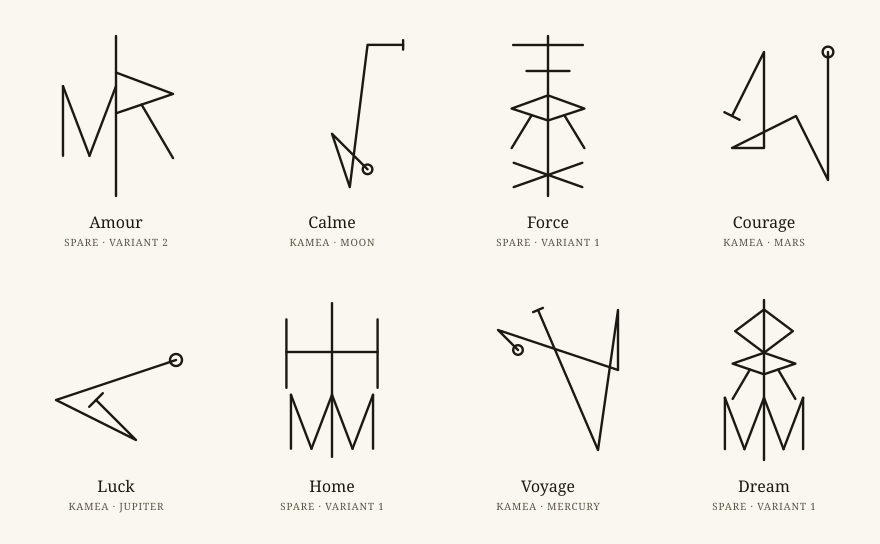

# Sigil

[English](README.md) · **Français**

Transformez un mot en sigil, tracé selon les méthodes traditionnelles : sur un carré
magique planétaire (kamea), ou avec la méthode d'Austin Osman Spare composée en rune liée.
Le sigil se trace sous vos yeux, chaque étape est expliquée, et vous pouvez l'exporter en
SVG, en PNG ou en pochoir PDF à taille réelle pour un tatoueur. Tout se passe dans votre
navigateur : le mot que vous tapez n'en sort jamais.

<p align="center">
  
  
</p>

<p align="center">
  
</p>

**[Essayer la démo](https://enzotekrennes.github.io/sigil/)** ·
**[Documentation](https://enzotekrennes.github.io/sigil/docs/fr/)** (français et anglais)

## Fonctionnalités

- **Kamea** : les sept carrés planétaires d'Agrippa (Saturne 3×3 à la Lune 9×9). Chaque
  lettre devient un nombre (A=1 … Z=26, avec retour au début au-delà du nombre de cases),
  le chemin relie les cases, avec un cercle au départ, un trait à l'arrivée et une boucle
  sur les cases répétées.
- **Spare, en rune liée** : les lettres répétées et les voyelles sont retirées, les lettres
  restantes sont redessinées en traits droits et accrochées à une hampe centrale. Même mot,
  même sigil ; « Autre variante » propose une autre composition, tout aussi stable.
- **Comment c'est fait** : un panneau montre chaque étape (lettres retirées, nombres,
  chemin sur le carré, squelettes, points d'accroche sur la hampe).
- **Style** : épaisseur du trait, extrémités rondes ou plates, cercle d'encadrement ; mode
  pochoir tatouage en noir pur.
- **Export** : SVG, PNG (1024 à 4096 px) et PDF A4 à taille réelle en centimètres, avec
  une règle de contrôle de 1 cm.
- Interface en français et en anglais, thèmes « encre sur papier » et « or sur noir »,
  fonctionne hors ligne et s'installe comme une application.

## Confidentialité

Aucun serveur, aucune mesure d'audience, aucun cookie. Le mot reste dans la mémoire de la
page : il n'est jamais envoyé, jamais stocké, jamais mis dans l'URL, et les fichiers
exportés ne le contiennent pas. Seules deux préférences sont gardées dans le navigateur
(`sigil.language`, `sigil.theme`). Le site est hébergé sur GitHub Pages, qui journalise
l'adresse IP des visiteurs selon sa propre politique.

Un sigil kamea peut être relu par qui connaît la méthode (les lettres correspondent à des
cases) ; une rune liée Spare est beaucoup moins réversible. L'app le signale avant l'export.

## Prérequis

- Node.js 22.13+ ou 24+
- npm

## Lancer

```sh
npm ci
npm run dev        # serveur de développement, http://localhost:5173/sigil/
```

## Tester

```sh
npm run lint          # ESLint (règles avec typage, contrôle TSDoc)
npm run format:check  # Prettier, vérification seule (npm run format réécrit les fichiers)
npm run typecheck     # TypeScript, mode strict
npm run test          # tests unitaires (Vitest + Testing Library)
npm run test:scripts  # tests des scripts de génération (Node test runner)
npx playwright install chromium   # une fois, avant le premier lancement de bout en bout
npm run test:e2e      # tests de bout en bout (Playwright) sur le build de production
```

## Construire

```sh
npm run build      # site statique dans dist/, servi sous /sigil/
npm run preview    # sert dist/ sur http://localhost:4173/sigil/
```

Aucune variable d'environnement n'est nécessaire.

Le site de documentation vit dans `site/` (Starlight), avec ses propres dépendances :

```sh
cd site
npm ci
npm run build      # site/dist/, publié sous /sigil/docs/
npm run preview    # http://localhost:4321/sigil/docs/
```

## Déployer

Le workflow `.github/workflows/deploy.yml` publie sur GitHub Pages, à l'adresse
`https://enzotekrennes.github.io/sigil/`, à chaque push sur `main`, ou à la main (Actions →
Deploy to GitHub Pages → Run workflow). Il lance le formatage, le lint, la vérification des
types, les tests unitaires, les tests des scripts, le build, les tests de bout en bout de
confidentialité et de fonctionnement hors ligne, construit la documentation dans
`dist/docs/`, puis publie. Les actions sont figées par SHA de commit, les droits sont
minimaux pour chaque job, et Dependabot propose les mises à jour chaque semaine.

Réglage unique sur GitHub : Settings → Pages → Build and deployment → Source :
**GitHub Actions**. Si le dépôt ne s'appelle pas `sigil`, changez `BASE_PATH` et
`DOCS_NAVIGATION_PATTERN` dans `vite.config.ts`, l'URL de base dans `playwright.config.ts`,
ainsi que `BASE_PATH` et la liste `APP_LINKS` dans `site/astro.config.mjs`.

Le build est une PWA installable : un service worker met chaque fichier en cache, l'app
fonctionne donc hors ligne après la première visite, et un nouveau déploiement est pris en
compte à la visite suivante. GitHub Pages ne permet pas d'en-têtes personnalisés : la
politique de sécurité du contenu (CSP) et la politique de référent sont des balises
`<meta>` dans `index.html`. Le serveur de développement retire la balise CSP (son
rechargement à chaud repose sur des scripts et styles en ligne) ; `npm run preview` et les
tests de bout en bout tournent avec elle.

## Fichiers générés

- **Glyphes Spare** : `src/features/spare/glyphs/hersheyRomanSimplex.ts` est généré à partir
  du fichier de police Hershey Roman Simplex, qui n'est pas versionné. Téléchargez
  [`rowmans.jhf`](https://raw.githubusercontent.com/kamalmostafa/hershey-fonts/master/hershey-fonts/rowmans.jhf)
  hors du dépôt, puis lancez `npm run glyphs:generate -- <chemin vers rowmans.jhf>`.
  Le script vérifie l'empreinte SHA-256 du fichier avant de le convertir ; le résultat est
  déterministe.
- **Images du README** : `.github/readme/*.svg` sont produites par `npm run readme:assets`,
  avec la géométrie de l'app elle-même (déterministe elle aussi).
- **Icônes de la PWA** : `public/icon.svg` (aussi favicon) et `public/icon-maskable.svg`
  sont les sources des fichiers PNG voisins, exportés en 180, 192 et 512 px.

## Licence

Code sous [licence MIT](LICENSE), © 2026 Enzo Monnier, avec ces exceptions, détaillées dans
[NOTICE](NOTICE) :

- Polices : EB Garamond et IBM Plex Mono, SIL Open Font License 1.1
  (`src/assets/fonts/*/OFL.txt`).
- Squelettes des lettres de la méthode Spare (`src/features/spare/glyphs/`) : données
  Hershey Fonts (Roman Simplex A–Z), sous l'avis d'utilisation de la distribution Hershey
  Fonts, qui exige que ses remerciements accompagnent les données.
- Dépendances embarquées (React, pdf-lib et leurs dépendances, runtime Workbox) : leurs
  licences sont rassemblées par le build dans `THIRD-PARTY-LICENSES.txt`.

Le site construit publie à sa racine `LICENSE.txt`, `NOTICE.txt`,
`THIRD-PARTY-LICENSES.txt` et les deux licences des polices, mis en cache pour l'usage hors
ligne, et le JavaScript minifié conserve les commentaires légaux (`/*!`, `@license`), dont
les remerciements Hershey.
