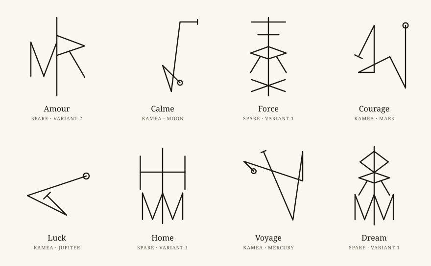

# Sigil

Turn a single word into a sigil, drawn the traditional ways: on a planetary magic
square (kamea), or with Austin Osman Spare's method composed as a bind rune. The sigil
is traced before your eyes, every step is explained, and you can export it as SVG, PNG
or a real-size PDF stencil for a tattoo artist. Everything runs in your browser: the
word you type never leaves it.

<p align="center">
  
  
</p>

<p align="center">
  
</p>

**[Try the demo](https://enzotekrennes.github.io/sigil/)** ·
**[Documentation](https://enzotekrennes.github.io/sigil/docs/)** (English and French)

## Features

- **Kamea**: the seven planetary squares of Agrippa (Saturn 3×3 to Moon 9×9). Each
  letter becomes a number (A=1 … Z=26, wrapping past the number of cells), the path joins
  the cells, with a circle at the start, a bar at the end and a loop on repeated cells.
- **Spare, as a bind rune**: repeated letters and vowels are removed, the remaining
  letters are redrawn with straight strokes and hung on a central stem. Same word, same
  sigil; "Another variant" gives a different, equally stable composition.
- **How it's made**: a panel shows every step (letters removed, numbers, path on the
  square, skeletons, attachments on the stem).
- **Style**: stroke width, round or flat ends, framing circle; tattoo stencil mode in
  pure black.
- **Export**: SVG, PNG (1024 to 4096 px), and an A4 PDF at real size in centimetres with
  a 1 cm control ruler.
- English and French interface, "ink on paper" and "gold on black" themes, works offline
  and installs as an app.

## Privacy

There is no server, no analytics, no cookie. The word stays in the page's memory: it is
never sent, never stored, never put in the URL, and exported files do not contain it.
Only two preferences are kept in the browser (`sigil.language`, `sigil.theme`). The site
is hosted on GitHub Pages, which logs visitors' IP addresses under GitHub's own policy.

A kamea sigil can be read back by someone who knows the method (letters map to cells);
a Spare bind rune is much less reversible. The app says so before you export.

## Requirements

- Node.js 22.13+ or 24+
- npm

## Run

```sh
npm ci
npm run dev        # development server, http://localhost:5173/sigil/
```

## Test

```sh
npm run lint          # ESLint (type-aware rules, TSDoc checks)
npm run format:check  # Prettier, check only (npm run format rewrites the files)
npm run typecheck     # TypeScript, strict mode
npm run test          # unit tests (Vitest + Testing Library)
npm run test:scripts  # tests of the generation scripts (Node test runner)
npx playwright install chromium   # once, before the first end-to-end run
npm run test:e2e      # end-to-end tests (Playwright) against the production build
```

## Build

```sh
npm run build      # static site in dist/, served under /sigil/
npm run preview    # serves dist/ at http://localhost:4173/sigil/
```

No environment variable is needed.

The documentation site lives in `site/` (Starlight) with its own dependencies:

```sh
cd site
npm ci
npm run build      # site/dist/, published under /sigil/docs/
npm run preview    # http://localhost:4321/sigil/docs/
```

## Deploy

The workflow `.github/workflows/deploy.yml` publishes to GitHub Pages at
`https://enzotekrennes.github.io/sigil/` on every push to `main`, or by hand (Actions →
Deploy to GitHub Pages → Run workflow). It runs format, lint, type-check, unit tests,
script tests, the build, the privacy and offline end-to-end tests, builds the
documentation into `dist/docs/`, then publishes. Actions are pinned by commit SHA,
permissions are minimal per job, and Dependabot proposes updates weekly.

One-time setup on GitHub: Settings → Pages → Build and deployment → Source:
**GitHub Actions**. If the repository is not named `sigil`, change `BASE_PATH` and
`DOCS_NAVIGATION_PATTERN` in `vite.config.ts`, the base URL in `playwright.config.ts`,
and `BASE_PATH` and the `APP_LINKS` list in `site/astro.config.mjs`.

The build is an installable PWA: a service worker precaches every file, so the app
works offline after the first visit, and a new deploy is picked up on the next visit.
GitHub Pages cannot send custom headers, so the Content Security Policy and the
referrer policy are `<meta>` elements in `index.html`. The dev server removes the CSP
`<meta>` (its hot reload relies on inline scripts and styles); `npm run preview` and
the end-to-end tests run with it.

## Generated files

- **Spare glyphs**: `src/features/spare/glyphs/hersheyRomanSimplex.ts` is generated from
  the Hershey Roman Simplex font file, which is not versioned. Download
  [`rowmans.jhf`](https://raw.githubusercontent.com/kamalmostafa/hershey-fonts/master/hershey-fonts/rowmans.jhf)
  outside the repository, then run `npm run glyphs:generate -- <path to rowmans.jhf>`.
  The script checks the file's SHA-256 before converting it; the output is
  deterministic.
- **README images**: `.github/readme/*.svg` come from `npm run readme:assets`, drawn with
  the app's own geometry (deterministic as well).
- **PWA icons**: `public/icon.svg` (also the favicon) and `public/icon-maskable.svg` are
  the sources of the PNG files next to them, exported at 180, 192 and 512 px.

## Licence

Code under the [MIT licence](LICENSE), with these exceptions, detailed in
[NOTICE](NOTICE):

- Fonts: EB Garamond and IBM Plex Mono, SIL Open Font License 1.1
  (`src/assets/fonts/*/OFL.txt`).
- Letter skeletons of the Spare method (`src/features/spare/glyphs/`): Hershey Fonts
  data (Roman Simplex A–Z), under the usage notice of the Hershey Fonts distribution,
  which requires its acknowledgements to travel with the data.
- Bundled dependencies (React, pdf-lib and their dependencies, Workbox runtime): their
  licences are collected by the build into `THIRD-PARTY-LICENSES.txt`.

The built site publishes `LICENSE.txt`, `NOTICE.txt`, `THIRD-PARTY-LICENSES.txt` and the
two font licences at its root, precached for offline use, and the minified JavaScript
keeps the legal comments (`/*!`, `@license`), including the Hershey acknowledgements.
