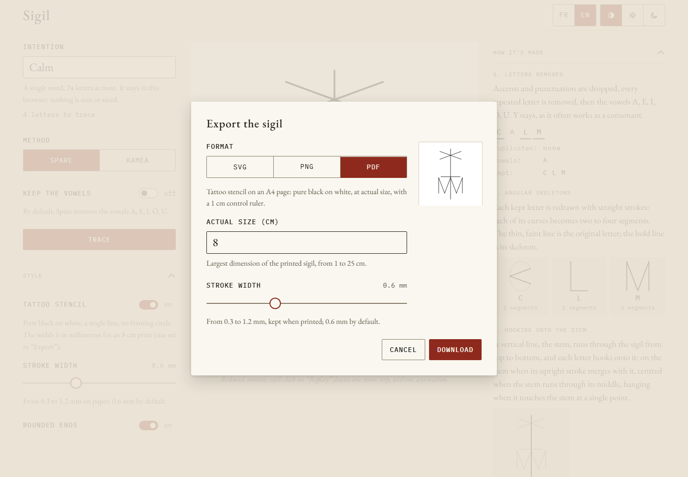

Press **Export** under the sigil. The button is disabled until a sigil is traced. The
**Export the sigil** dialog shows a preview of the file to come; pick a **Format**, then
press **Download**.

## The three formats

| Format | What you get | Settings |
|---|---|---|
| **SVG** | Vector drawing on a square background, sharp at any size, for an editor or the web. Its colours are those of the current theme (black on white in stencil mode), written into the file so it looks the same outside the app. | None |
| **PNG** | Square image on the theme background (white in stencil mode). | **Resolution**: 1024, 2048 (default) or 4096 px |
| **PDF** | Tattoo stencil on an A4 page: pure black on white, at actual size, with a 1 cm control ruler. | **Actual size (cm)** and **Stroke width** (mm) |

The kamea grid shown on screen is never exported.

## Files never carry the intention

The file is named after the method and the moment of the export, for example
`sigil-kamea-20261108-093005.svg`. Neither its name nor its content holds the word you
typed. The PDF metadata say only “Sigil” and the export date.

For a kamea sigil, the dialog reminds you that someone who knows the method can read the
letters back from the cells. See [Limits](/sigil/docs/en/methods/limits/).

## The stencil PDF, for a tattoo artist

The PDF is always a stencil, whatever the theme:

- **Actual size (cm)**: the largest dimension of the sigil as printed, stroke included.
  From 1 to 25 cm, 8 cm by default. Decimals are accepted (6.5).
- The page is an A4 portrait sheet: a sigil wider than tall is limited to about 19 cm.
  When the size is too large for the page, the dialog says the largest size that fits
  and the download is blocked until you change it.
- **Stroke width**: from 0.3 to 1.2 mm on paper, 0.6 mm by default. It is shared with
  the **Style** section in stencil mode.

At the bottom of the page, a band carries a 1 cm ruler, the size and stroke of the sigil, and the
printing instruction.

### Printing and checking

1. Open the PDF and print it **at 100%**, with no scaling and no “fit to page”, as the
   page itself says.
2. With a ruler, check the **1 cm** control ruler on the paper. If it does not measure
   1 cm, the printer scaled the page: print again with the scaling off.
3. Measure the sigil along its largest dimension: it must match the size written on the
   page (“Sigil: 8 cm along its largest dimension…”).

The tattoo artist only needs the PDF and these three steps; they do not need to use the
app.

## When an export fails

If a download fails, a message says which format failed. Try again; if it keeps failing,
try another browser.
