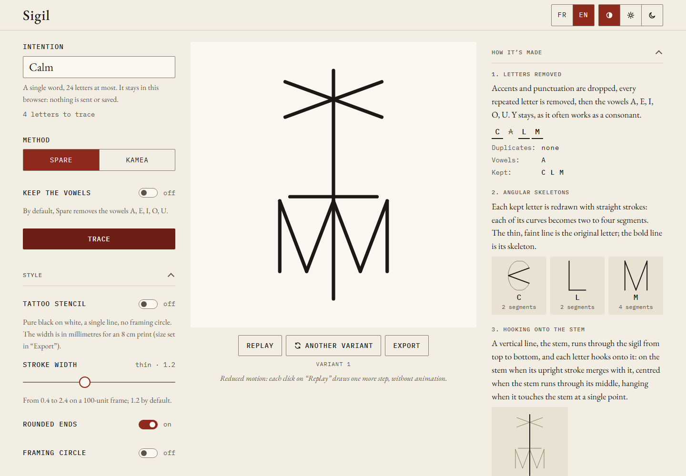

The screen has three parts: the controls on the left, the sigil in the middle, and the
**How it’s made** panel on the right. On a phone they are stacked in that order.

## 1. Write the intention

Type your intention in the **Intention** field.

- **One word only**, without spaces: beyond one word, the sigil becomes unreadable.
  Keep the word that carries your intention, for example “Calm”.
- **24 letters at most**, counted once accents are removed. The counter under the field
  says how many letters will be traced.
- Accents and case do not matter: “Sérénité” and “serenite” give the same letters.
  Œ, Æ and ß count as OE, AE and SS.
- An apostrophe or a hyphen inside the word is accepted and ignored
  (“aujourd’hui”, “peut-être”). Punctuation after a space, as French typography writes
  it, is tolerated (“Calme !”).
- Only the letters A to Z are traced. Digits, symbols and letters of other scripts are
  dropped, and a message lists them under **Ignored characters**.

If the text cannot be traced, a message under the field says what to change: no Latin
letter, several words, or too many letters.

## 2. Choose a method

Under **Method**, pick **Kamea** (the default) or **Spare**.

- **Kamea**: choose a **Planetary square**, from Saturn 3×3 to the Moon 9×9. Saturn is
  selected on first load. See [the kamea method](/sigil/docs/en/methods/kamea/).
- **Spare**: the **Keep the vowels** switch is off by default, so Spare removes the
  vowels A, E, I, O, U (Y stays). See [Spare’s method](/sigil/docs/en/methods/spare/).

## 3. Trace

Press **Trace**. The sigil draws itself along its path, then its marks appear.

Changing the square, the method or the vowel option does not redraw the sigil on its own:
press **Trace** again. This keeps the animation from restarting at every click.

Some words cannot be traced with every setting; the message says why and what to do:

- with kamea, a single letter makes no path, and a word whose letters all land on the
  same cell would be a single dot: choose another square or add letters;
- with Spare, a word made only of vowels leaves no letter. The message then offers a
  **Keep the vowels and trace** button.

## 4. Read the “How it’s made” panel

Once the sigil is traced, the panel shows every step of the calculation.

For a kamea sigil:

1. **Letters traced**: the letters kept, accents removed, repetitions included.
2. **Conversion rule**: how each letter becomes a cell number on the chosen square,
   with the formula and an example.
3. **Letter → number**: the table of letters, ranks and cells.
4. **Path on the square**: the square with the path drawn over it.

For a Spare sigil:

1. **Letters removed**: duplicates and vowels struck through, and the letters kept.
2. **Angular skeletons**: each kept letter redrawn with straight strokes.
3. **Hooking onto the stem**: how each letter is hooked onto the vertical stem.
4. **Choosing the variant**: the style of the variant and why this rune was kept.
5. **Simplification**: how many segments are left once shared strokes are drawn once.

## 5. Replay and try other variants

- **Replay** draws the sigil again.
- **Another variant** (Spare only) draws another rune from the same letters. Variants are
  numbered from 1 under the sigil. Variant *n* of a word, with the same vowel option, is
  always the same rune, today or after a reload: trace the word, then press the button
  *n* − 1 times. Changing the word, the method or the vowel option starts again from
  variant 1.

If your system asks for reduced motion, the sigil appears without animation. Each click on
**Replay** then draws one more step, without animation, and a line under the buttons tells
you which step is shown.

## Next

- [Style, theme and language](/sigil/docs/en/guide/style/)
- [Export the sigil](/sigil/docs/en/guide/export/)
