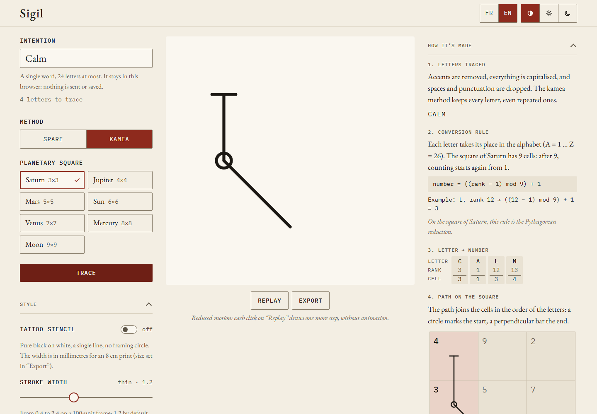

Sigil turns an intention, written as a single word, into a sigil drawn in SVG. It applies
one of two traditional methods, step by step, and shows how the sigil was built:

- the **kamea** method traces the letters as a path on one of the seven planetary magic
  squares of Agrippa;
- **Spare's** method removes repeated letters and vowels, then binds the remaining letters
  into a **bind rune**: angular letters hooked onto a vertical **stem**.

The same word with the same method and settings always gives the same sigil. Everything
happens in the browser: the intention is never sent anywhere or saved.

## Who it is for

- **People curious about sigils or generative art**, who want to see how a sigil is built.
- **People preparing a tattoo**, who need a clean file for their tattoo artist: Sigil
  exports a stencil PDF at actual size.
- **Tattoo artists** who receive that file. They do not need to use the app: the
  [export guide](/sigil/docs/en/guide/export/) explains how to check the print.

## Where to start

| You want to… | Read |
|---|---|
| Trace your first sigil | [Trace a sigil](/sigil/docs/en/guide/trace/) |
| Change the stroke, the theme or the language | [Style, theme and language](/sigil/docs/en/guide/style/) |
| Get an SVG, a PNG or a tattoo stencil PDF | [Export](/sigil/docs/en/guide/export/) |
| Use Sigil without a connection, or install it | [Offline and installation](/sigil/docs/en/guide/offline/) |
| Understand the methods | [The kamea method](/sigil/docs/en/methods/kamea/), [Spare's method](/sigil/docs/en/methods/spare/), [Limits](/sigil/docs/en/methods/limits/) |
| Know what happens to what you type | [Privacy](/sigil/docs/en/privacy/) |
| Run, test or change the code | [Getting started](/sigil/docs/en/getting-started/), [Architecture](/sigil/docs/en/architecture/) |

## In short

- Static web app: React 19, TypeScript and Vite, published on GitHub Pages under `/sigil/`.
- Installable and usable offline after a first visit.
- Interface in English and French, two themes: “Ink on paper” and “Gold on black”.
- Code under the MIT licence; fonts and letter data under their own licences, see
  [Credits and licences](/sigil/docs/en/credits/).
