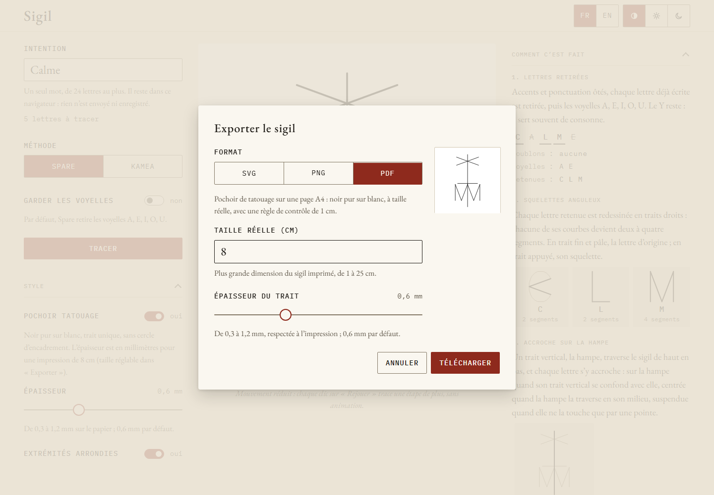

Appuyez sur **Exporter** sous le sigil. Le bouton reste désactivé tant qu'aucun sigil n'est
tracé. La boîte **Exporter le sigil** montre un aperçu du fichier à venir ; choisissez un
**Format**, puis appuyez sur **Télécharger**.

## Les trois formats

| Format | Ce que vous obtenez | Réglages |
|---|---|---|
| **SVG** | Dessin vectoriel sur un fond carré, net à toute taille, pour un éditeur ou le web. Ses couleurs sont celles du thème courant (noir sur blanc en mode pochoir), écrites dans le fichier pour qu'il s'affiche pareil hors de l'app. | Aucun |
| **PNG** | Image carrée sur le fond du thème (blanc en mode pochoir). | **Résolution** : 1024, 2048 (par défaut) ou 4096 px |
| **PDF** | Pochoir de tatouage sur une page A4 : noir pur sur blanc, à taille réelle, avec une règle de contrôle de 1 cm. | **Taille réelle (cm)** et **Épaisseur du trait** (mm) |

La grille kamea affichée à l'écran n'est jamais exportée.

## Les fichiers ne contiennent jamais l'intention

Le fichier porte le nom de la méthode et le moment de l'export, par exemple
`sigil-kamea-20261108-093005.svg`. Ni son nom ni son contenu ne contiennent le mot tapé.
Les métadonnées du PDF ne disent que « Sigil » et la date de l'export.

Pour un sigil kamea, la boîte rappelle que quelqu'un qui connaît la méthode peut relire les
lettres à partir des cases. Voir [Limites](/sigil/docs/fr/methods/limits/).

## Le pochoir PDF, pour un tatoueur

Le PDF est toujours un pochoir, quel que soit le thème :

- **Taille réelle (cm)** : la plus grande dimension du sigil imprimé, trait compris. De 1
  à 25 cm, 8 cm par défaut. Les décimales sont acceptées (6,5).
- La page est une feuille A4 en portrait : un sigil plus large que haut est limité à
  environ 19 cm. Quand la taille est trop grande pour la page, la boîte indique la plus
  grande taille qui tient, et le téléchargement est bloqué jusqu'à ce que vous la changiez.
- **Épaisseur du trait** : de 0,3 à 1,2 mm sur le papier, 0,6 mm par défaut. Elle est
  partagée avec la section **Style** en mode pochoir.

En bas de la page, un bandeau porte une règle de 1 cm, la taille et le trait du sigil, et
la consigne d'impression.

### Imprimer et vérifier

1. Ouvrez le PDF et imprimez-le **à 100 %**, sans mise à l'échelle ni ajustement à la page,
   comme l'indique la page elle-même.
2. Avec une règle, vérifiez la règle de contrôle de **1 cm** sur le papier. Si elle ne
   mesure pas 1 cm, l'imprimante a mis la page à l'échelle : imprimez de nouveau sans mise
   à l'échelle.
3. Mesurez le sigil dans sa plus grande dimension : elle doit correspondre à la taille
   écrite sur la page (« Sigil : 8 cm dans sa plus grande dimension… »).

Le tatoueur n'a besoin que du PDF et de ces trois étapes ; il n'a pas besoin d'utiliser
l'app.

## Quand un export échoue

Si un téléchargement échoue, un message indique le format en cause. Réessayez ; si l'échec
persiste, essayez un autre navigateur.
