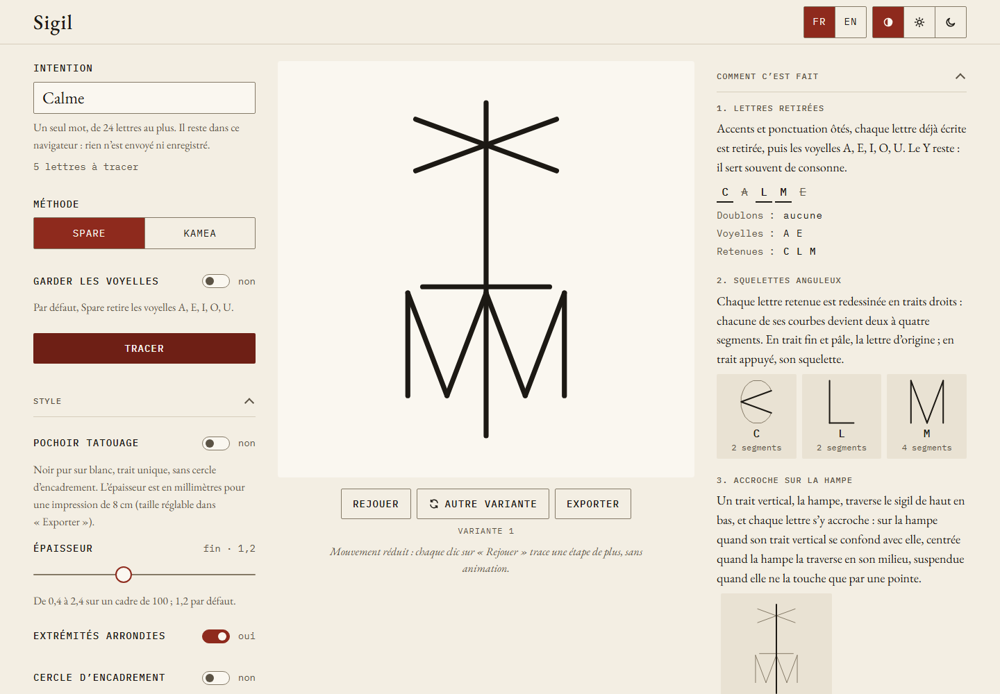

L'écran a trois parties : les réglages à gauche, le sigil au centre, et le panneau
**Comment c'est fait** à droite. Sur téléphone, elles s'empilent dans cet ordre.

## 1. Écrire l'intention

Tapez votre intention dans le champ **Intention**.

- **Un seul mot**, sans espace : au-delà d'un mot, le sigil devient illisible. Gardez le
  mot qui porte votre intention, par exemple « Calme ».
- **24 lettres au plus**, comptées une fois les accents retirés. Le compteur sous le champ
  indique combien de lettres seront tracées.
- Accents et majuscules ne comptent pas : « Sérénité » et « serenite » donnent les mêmes
  lettres. Œ, Æ et ß comptent pour OE, AE et SS.
- Une apostrophe ou un trait d'union à l'intérieur du mot est accepté et ignoré
  (« aujourd'hui », « peut-être »). Une ponctuation après une espace, comme l'écrit la
  typographie française, est tolérée (« Calme ! »).
- Seules les lettres A à Z sont tracées. Chiffres, symboles et lettres d'autres écritures
  sont écartés, et un message les liste sous **Caractères ignorés**.

Si le texte ne peut pas être tracé, un message sous le champ dit quoi changer : aucune
lettre latine, plusieurs mots, ou trop de lettres.

## 2. Choisir une méthode

Sous **Méthode**, choisissez **Kamea** (par défaut) ou **Spare**.

- **Kamea** : choisissez un **Carré planétaire**, de Saturne 3×3 à la Lune 9×9. Saturne
  est sélectionné au premier chargement. Voir [la méthode kamea](/sigil/docs/fr/methods/kamea/).
- **Spare** : l'interrupteur **Garder les voyelles** est sur non par défaut, donc Spare
  retire les voyelles A, E, I, O, U (le Y reste). Voir
  [la méthode de Spare](/sigil/docs/fr/methods/spare/).

## 3. Tracer

Appuyez sur **Tracer**. Le sigil se dessine le long de son chemin, puis ses marques
apparaissent.

Changer de carré, de méthode ou d'option de voyelles ne redessine pas le sigil de
lui-même : appuyez de nouveau sur **Tracer**. L'animation ne repart donc pas à chaque clic.

Certains mots ne peuvent pas être tracés avec tous les réglages ; le message dit pourquoi
et quoi faire :

- en kamea, une seule lettre ne trace aucun chemin, et un mot dont toutes les lettres
  tombent sur la même case serait un simple point : choisissez un autre carré ou ajoutez
  des lettres ;
- en Spare, un mot fait seulement de voyelles ne laisse aucune lettre. Le message propose
  alors un bouton **Garder les voyelles et tracer**.

## 4. Lire le panneau « Comment c'est fait »

Une fois le sigil tracé, le panneau montre chaque étape du calcul.

Pour un sigil kamea :

1. **Lettres tracées** : les lettres gardées, accents retirés, répétitions comprises.
2. **Règle de conversion** : comment chaque lettre devient un numéro de case sur le carré
   choisi, avec la formule et un exemple.
3. **Lettre → nombre** : la table des lettres, rangs et cases.
4. **Chemin sur le carré** : le carré avec le chemin tracé par-dessus.

Pour un sigil de Spare :

1. **Lettres retirées** : doublons et voyelles barrés, et les lettres retenues.
2. **Squelettes anguleux** : chaque lettre retenue redessinée en traits droits.
3. **Accroche sur la hampe** : comment chaque lettre s'accroche à la hampe verticale.
4. **Choix de la variante** : le style de la variante et pourquoi cette rune a été retenue.
5. **Simplification** : combien de segments restent une fois les traits communs tracés une
   seule fois.

## 5. Rejouer et essayer d'autres variantes

- **Rejouer** dessine de nouveau le sigil.
- **Autre variante** (Spare seulement) tire une autre rune des mêmes lettres. Les
  variantes sont numérotées à partir de 1 sous le sigil. La variante *n* d'un mot, avec la
  même option de voyelles, est toujours la même rune, aujourd'hui ou après un
  rechargement : tracez le mot, puis appuyez *n* − 1 fois sur le bouton. Changer de mot, de
  méthode ou d'option de voyelles repart de la variante 1.

Si votre système demande de réduire les animations, le sigil s'affiche sans animation.
Chaque clic sur **Rejouer** trace alors une étape de plus, sans animation, et une ligne
sous les boutons indique l'étape affichée.

## Ensuite

- [Style, thème et langue](/sigil/docs/fr/guide/style/)
- [Exporter le sigil](/sigil/docs/fr/guide/export/)
