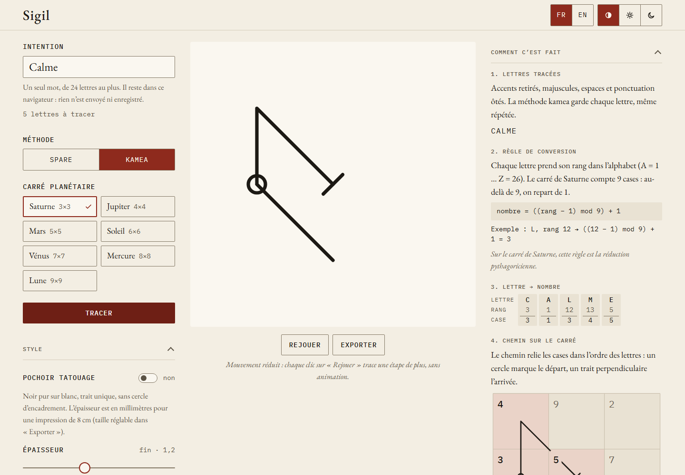

Sigil transforme une intention, écrite en un seul mot, en un sigil tracé en SVG. Il
applique l'une de deux méthodes traditionnelles, étape par étape, et montre comment le
sigil a été construit :

- la méthode **kamea** trace les lettres comme un chemin sur l'un des sept carrés
  magiques planétaires d'Agrippa ;
- la méthode de **Spare** retire les lettres répétées et les voyelles, puis lie les lettres
  restantes en une **rune liée** : des lettres anguleuses accrochées à une **hampe**
  verticale.

Le même mot avec la même méthode et les mêmes réglages donne toujours le même sigil. Tout
se passe dans le navigateur : l'intention n'est jamais envoyée ni enregistrée.

## À qui il s'adresse

- **Aux curieux des sigils ou de l'art génératif**, qui veulent voir comment un sigil se
  construit.
- **À qui prépare un tatouage** et a besoin d'un fichier propre pour son tatoueur : Sigil
  exporte un pochoir PDF à taille réelle.
- **Aux tatoueurs** qui reçoivent ce fichier. Ils n'ont pas besoin d'utiliser l'app : le
  [guide de l'export](/sigil/docs/fr/guide/export/) explique comment vérifier l'impression.

## Par où commencer

| Vous voulez… | À lire |
|---|---|
| Tracer votre premier sigil | [Tracer un sigil](/sigil/docs/fr/guide/trace/) |
| Changer le trait, le thème ou la langue | [Style, thème et langue](/sigil/docs/fr/guide/style/) |
| Obtenir un SVG, un PNG ou un pochoir PDF de tatouage | [Exporter](/sigil/docs/fr/guide/export/) |
| Utiliser Sigil sans connexion, ou l'installer | [Hors ligne et installation](/sigil/docs/fr/guide/offline/) |
| Comprendre les méthodes | [La méthode kamea](/sigil/docs/fr/methods/kamea/), [La méthode de Spare](/sigil/docs/fr/methods/spare/), [Limites](/sigil/docs/fr/methods/limits/) |
| Savoir ce que devient ce que vous tapez | [Confidentialité](/sigil/docs/fr/privacy/) |
| Lancer, tester ou modifier le code | [Prise en main](/sigil/docs/fr/getting-started/), [Architecture](/sigil/docs/fr/architecture/) |

## En bref

- App web statique : React 19, TypeScript et Vite, publiée sur GitHub Pages sous `/sigil/`.
- Installable et utilisable hors ligne après une première visite.
- Interface en français et en anglais, deux thèmes : « Encre sur papier » et « Or sur
  noir ».
- Code sous licence MIT ; polices et données des lettres sous leurs propres licences, voir
  [Crédits et licences](/sigil/docs/fr/credits/).
